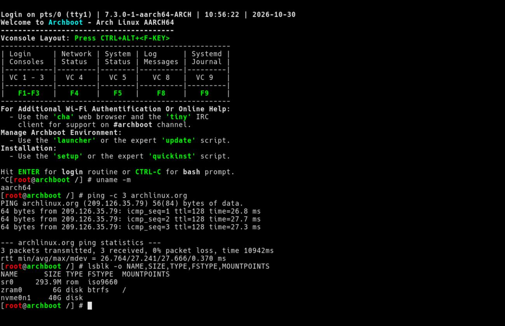
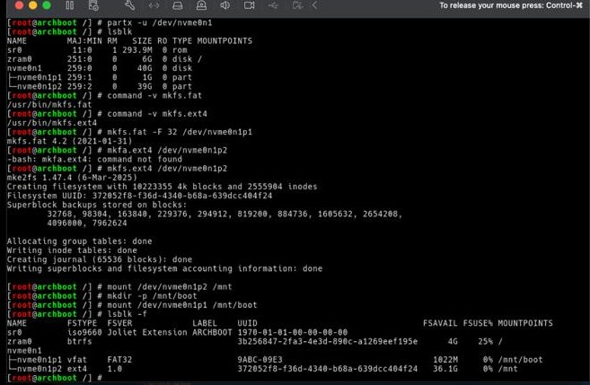
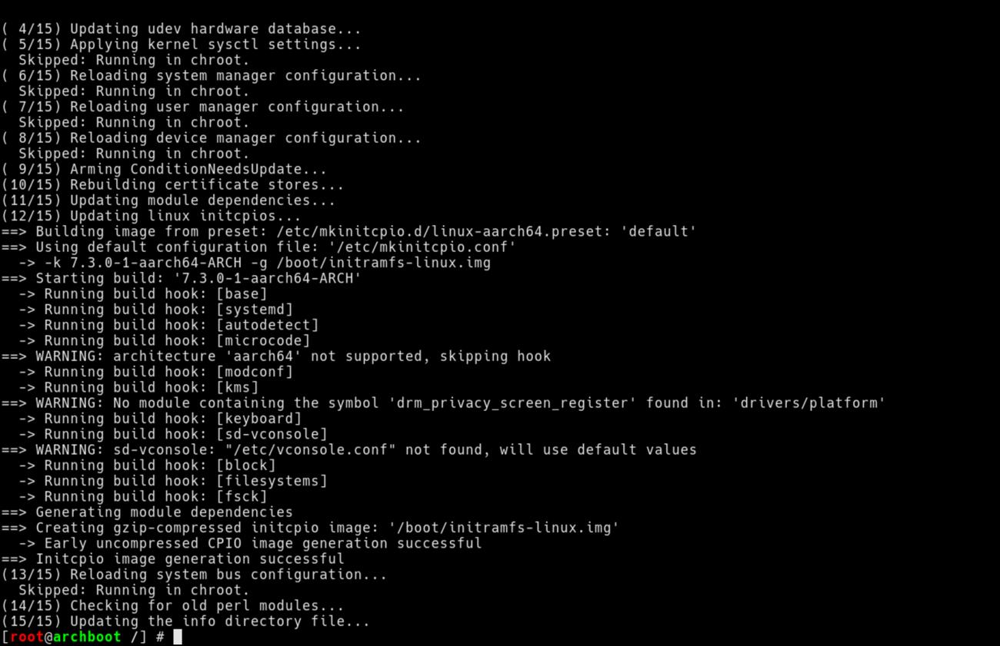
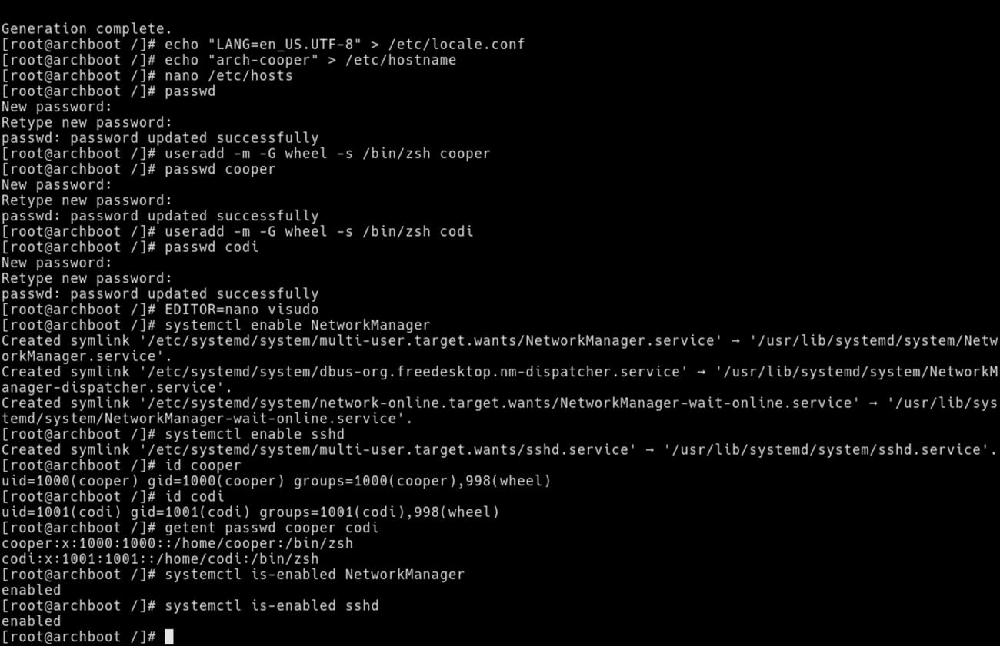
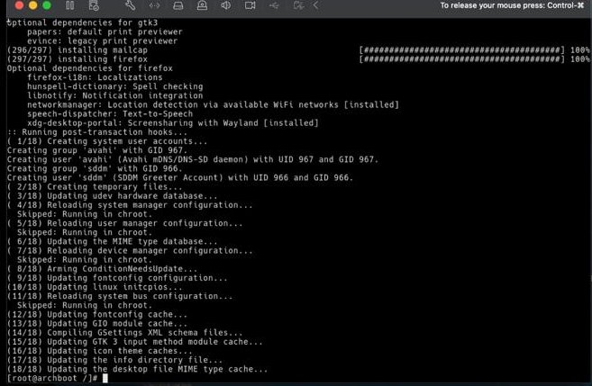
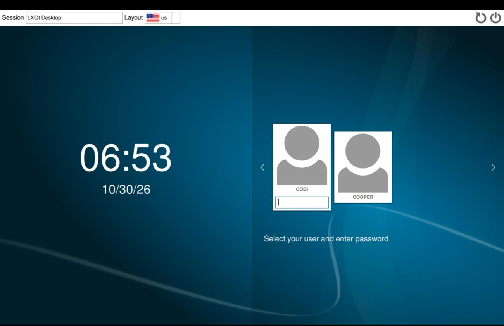
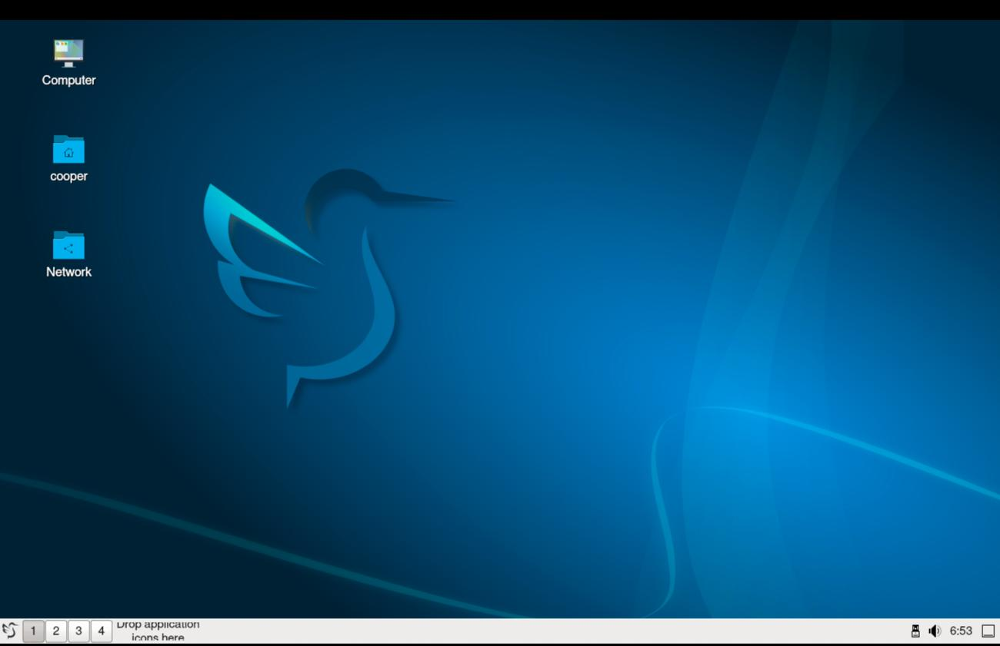
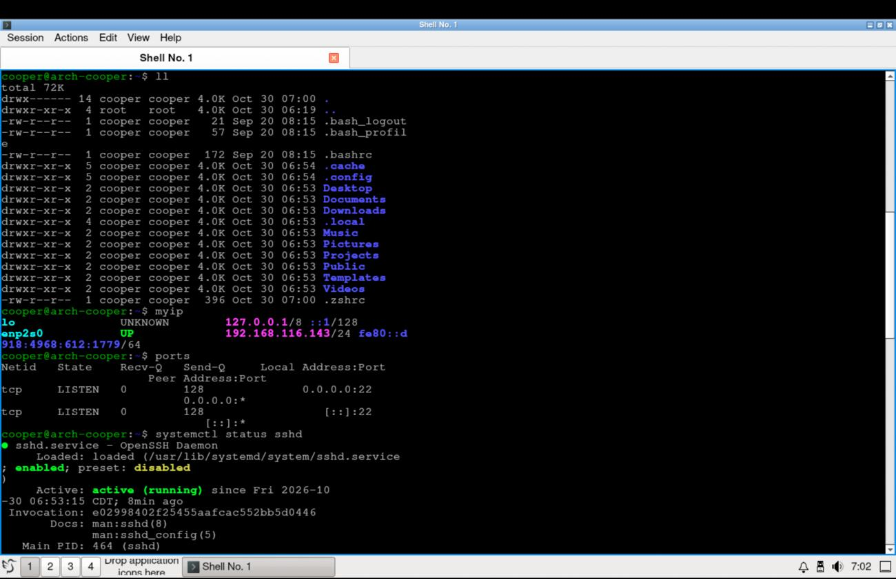
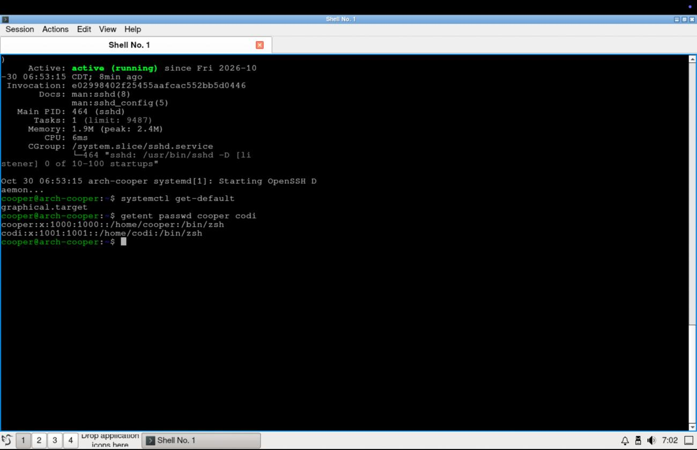

# Manual Arch Linux ARM Installation on VMware Fusion

**Installation date:** October 30, 2026  
**Platform:** Apple M2 MacBook Air · VMware Fusion · Arch Linux ARM (aarch64)  
**Purpose:** Install Arch Linux manually, configure a graphical desktop and administrative users, and document decisions and problems encountered.

> **Important:** This describes my particular virtual machine and is intended to help me reproduce it. It is **not** a copy of the Arch Wiki. I did not use `archinstall`, Archboot `setup`, or `quickinst`. Partition commands erase the selected virtual disk. Check disk names before running them.

## 1. VM setup and booting the installer

I created a **custom ARM64 Linux VM** in VMware Fusion with **4 CPU cores**, initially **4 GB RAM** (increased to **8 GB** while troubleshooting), **40 GB NVMe storage**, UEFI firmware, and **NAT networking**. I used the unofficial **Archboot aarch64** ISO linked by the instructor: <https://release.archboot.com/aarch64/latest/iso/>.

The normal `Launch UEFI Archboot – Arch Linux aarch64` option did not complete startup: it stopped at a `pam_nologin` message saying the system was still booting. I restarted, chose **Launch UEFI IPXE Archboot – Arch Linux aarch64**, authorized network access in macOS, and selected the Arch Linux aarch64 netboot entry. This downloaded the installer environment and brought me to the root Bash prompt after pressing **Ctrl+C** at the Archboot welcome screen. The network boot method solved the initial problem.

```bash
uname -m                  # Confirm aarch64 architecture
ping -c 3 archlinux.org    # Confirm Internet access
lsblk -o NAME,SIZE,TYPE,FSTYPE,MOUNTPOINTS  # Identify the blank 40 GB disk
```

My disk was **`/dev/nvme0n1`**; `zram0` and `sr0` belonged to the live installation environment and were not partitioned.



## 2. Partition, format, and mount

I chose a simple **GPT / UEFI** layout, **FAT32 for the 1 GB EFI System Partition**, and **ext4 for the remaining root filesystem**, without a separate swap partition.

```bash
command -v sgdisk         # Check partitioning tool availability
# If missing: pacman -Sy --needed gptfdisk
sgdisk --zap-all /dev/nvme0n1              # Clear old partition table on VM disk
sgdisk -n 1:0:+1G -t 1:ef00 /dev/nvme0n1  # Create 1 GB EFI partition
sgdisk -n 2:0:0 -t 2:8300 /dev/nvme0n1    # Create remaining Linux partition
partx -u /dev/nvme0n1                     # Refresh partition table in kernel
lsblk                                     # Confirm p1 and p2 exist
mkfs.fat -F 32 /dev/nvme0n1p1             # Format EFI as FAT32
mkfs.ext4 /dev/nvme0n1p2                 # Format root as ext4
mount /dev/nvme0n1p2 /mnt                # Mount future root filesystem
mkdir -p /mnt/boot                        # Create EFI mount directory
mount /dev/nvme0n1p1 /mnt/boot           # Mount EFI System Partition
lsblk -f                                  # Verify filesystem types and mounts
```

`partprobe` was unavailable in the live environment, so I used **`partx -u`** to refresh the partition information instead.



## 3. Install the base OS

I used **`pacstrap` manually**, choosing the ARM-specific kernel and the packages needed for the assignment.

```bash
command -v pacstrap       # Verify pacstrap exists in live environment
# If missing: pacman -Sy --needed arch-install-scripts
pacman -Sy               # Refresh installer package databases
pacstrap -K /mnt base linux-aarch64 sudo nano networkmanager openssh zsh git base-devel
                           # Install core ARM OS, administration, SSH, Zsh, and build tools
genfstab -U /mnt >> /mnt/etc/fstab         # Record root and EFI mounts using UUIDs
cat /mnt/etc/fstab                        # Check both entries
arch-chroot /mnt                          # Work inside installed system
cat /etc/os-release                       # Confirm Arch Linux ARM
ls -lh /boot                              # Check ARM kernel Image and initramfs
```

The kernel/initramfs build printed nonfatal ARM-specific warnings, but ended with **`Initcpio image generation successful`**. Kernel files included `/boot/Image` and `/boot/initramfs-linux.img`.



## 4. Locale, hostname, and users

Inside `arch-chroot`, I set Central Time, enabled US English UTF-8, and named the VM `arch-cooper`.

```bash
ln -sf /usr/share/zoneinfo/America/Chicago /etc/localtime  # Set timezone
hwclock --systohc                                          # Save system clock to RTC
export TERM=xterm                                          # Make Nano work in chroot
nano /etc/locale.gen                                       # Uncomment en_US.UTF-8 UTF-8
locale-gen                                                 # Generate selected locale
echo 'LANG=en_US.UTF-8' > /etc/locale.conf                  # Set default locale
echo 'arch-cooper' > /etc/hostname                          # Set hostname
nano /etc/hosts                                            # Add loopback hostname entries
passwd                                                     # Set root password (not documented)
useradd -m -G wheel -s /bin/zsh cooper                     # Personal user, wheel group, Zsh
passwd cooper                                              # Set password
useradd -m -G wheel -s /bin/zsh codi                       # Second required user
passwd codi                                                # Set password
EDITOR=nano visudo                                         # Enable wheel group sudo rule
```

In `/etc/hosts`, I used:

```text
127.0.0.1 localhost
::1       localhost
127.0.1.1 arch-cooper.localdomain arch-cooper
```

In `visudo`, I uncommented the rule **`%wheel ALL=(ALL:ALL) ALL`**. I never wrote account passwords into this documentation.

```bash
systemctl enable NetworkManager       # Start network manager on boot
systemctl enable sshd                 # Start SSH server on boot
id cooper                             # Verify wheel group membership
id codi                               # Verify wheel group membership
getent passwd cooper codi             # Verify both users and Zsh login shells
systemctl is-enabled NetworkManager   # Verify enabled
systemctl is-enabled sshd             # Verify enabled
```

**Problem and solution:** Running `nano /etc/locale.gen` initially failed with `Error opening terminal: xterm-kmscon`. Changing the terminal type with **`export TERM=xterm`** fixed it, and `locale-gen` completed.



## 5. Install the GUI and browser

I chose **LXQt** because it is lightweight, **Openbox** as its window manager, **SDDM** for graphical logins, and **Firefox** for browser/internet verification.

```bash
pacman -Syu                                       # Update packages
pacman -S --needed lxqt sddm xorg-server mesa openbox breeze-icons qterminal firefox
                                                    # Install desktop, Xorg, terminal, browser
systemctl enable sddm                             # Enable graphical login manager
systemctl set-default graphical.target            # Boot into GUI mode
systemctl get-default                             # Verify graphical.target
systemctl is-enabled sddm                         # Verify SDDM enabled
pacman -Q lxqt-session sddm xorg-server openbox firefox  # Verify actual package names
```

**Problem and solution:** The first desktop installation produced repeated **`unknown trust` / PGP signature** errors for packages signed by the Arch Linux ARM Build System. The installed system was missing the `archlinuxarm-keyring` package. I canceled the failing package transaction, investigated the keyring with `pacman -Q`, checked `/usr/share/pacman/keyrings/`, and found that `pacman -Si archlinuxarm-keyring` listed the missing package. After repairing trust in the official ARM signing key and installing/populating the ARM keyring, I retried the desktop installation successfully. **I did not disable package signature verification.**

The troubleshooting commands used or checked during this issue included:

```bash
pacman-key --init                         # Initialize key database
pacman -Q archlinuxarm-keyring            # Diagnose missing package
ls -l /usr/share/pacman/keyrings/         # Inspect available keyring files
pacman -Si archlinuxarm-keyring           # Inspect repository package
# Verify the official Arch Linux ARM signing key fingerprint before trusting it.
pacman-key --populate archlinuxarm        # Populate keys after keyring is installed
pacman -Sy archlinuxarm-keyring           # Install/update ARM keyring package
pacman -Syu                               # Refresh/update packages after repair
```

For the exact key-bootstrap and signature verification procedure, consult the [Arch Linux ARM documentation](https://archlinuxarm.org/) rather than trusting an unverified key supplied by a random website.



## 6. UEFI bootloader: systemd-boot

The EFI partition was mounted at `/boot`, and the ARM kernel was called `Image`. I installed **systemd-boot**, verified the boot entry and root UUID, and then booted successfully without the installation ISO.

```bash
ls /sys/firmware/efi/efivars                # Inspect UEFI variables from installer context
bootctl install                            # Copy systemd-boot to the EFI partition
mkdir -p /boot/loader/entries              # Create boot entry directory
nano /boot/loader/loader.conf              # Configure default entry and timeout
blkid /dev/nvme0n1p2                      # Identify root UUID
ROOT_UUID=$(blkid -s UUID -o value /dev/nvme0n1p2)  # Store root UUID
cat > /boot/loader/entries/arch.conf <<EOF
title Arch Linux ARM
linux /Image
initrd /initramfs-linux.img
options root=UUID=$ROOT_UUID rw
EOF
cat /boot/loader/entries/arch.conf          # Verify generated UUID and kernel paths
bootctl list                                # Verify Arch entry is detected
bootctl status                              # Inspect installed boot manager
```

The closing `EOF` above must be entered by itself, followed by Enter. My `/boot/loader/loader.conf` contained:

```text
default arch.conf
timeout 5
console-mode auto
editor no
```

`bootctl` printed **`Not booted with EFI or running in a container`** in the chroot. This did not prevent creating the EFI loader files. `bootctl list` still showed `Arch Linux ARM` as the default entry.

```bash
exit               # Leave chroot
umount -R /mnt     # Unmount installed system
poweroff           # Shut down live installer
```

I then **disconnected the ISO in VMware Fusion** and started the VM from the hard disk. It reached the **SDDM login screen** with both users and successfully logged into the **LXQt** desktop.





## 7. Zsh, terminal colors, and aliases

Logged in as `cooper`, I opened **QTerminal**. Both accounts were created with `/bin/zsh` as their login shell. In `~/.zshrc` I used:

```zsh
autoload -U colors && colors                  # Enable color features
PROMPT='%F{green}%n@%m%f:%F{blue}%~%f$ '      # Color username and working directory
alias ls='ls --color=auto'                    # Color directory listing
alias grep='grep --color=auto'                # Color grep matches
alias ll='ls -lah'                            # Long detailed listing
alias la='ls -A'                              # Include hidden files
alias cls='clear'                             # Clear terminal
alias update='sudo pacman -Syu'               # System update shortcut
alias myip='ip -br addr'                      # Show IP addresses
alias ports='ss -tuln'                        # Show listening ports
alias ..='cd ..'                              # Parent directory
alias ...='cd ../..'                          # Two parent directories
```

```bash
nano ~/.zshrc                  # Edit Zsh configuration
source ~/.zshrc               # Reload shell configuration
ll                            # Test long directory listing alias
myip                          # Test IP display alias
ports                         # Test listening ports alias
```



## 8. Verification of assignment requirements

```bash
whoami                        # Confirm logged in as cooper
printf '%s\n' "$SHELL"         # Confirm /bin/zsh
sudo whoami                   # Confirm sudo returns root
getent passwd cooper codi     # Display required user accounts
id cooper                     # Confirm wheel group
id codi                       # Confirm wheel group
sudo visudo                   # Safely inspect sudoers configuration
systemctl status sshd         # Confirm OpenSSH active (running); q exits pager
systemctl get-default         # Confirm graphical.target
ip -br addr                   # Show VM IP address
ss -tuln                      # Show listening SSH port 22
```

The VM received an address in VMware's NAT network (observed as **192.168.116.143** during verification). SSH was **active (running)**, SDDM launched automatically, and the terminal displayed colored output. Firefox was installed for browsing to the final GitHub Pages website.



## 9. AUR package demonstration (walkthrough video)

**Pending video task:** The assignment requires installing an Arch User Repository package during the walkthrough. The AUR is community-maintained and package builds may not support ARM64, so I will choose a small package with compatible `arch=('any')` or `aarch64` metadata and examine its `PKGBUILD` before using `makepkg -si` as a non-root user. Installing an AUR package is **not yet claimed as completed in this document**.

```bash
sudo pacman -S --needed base-devel git  # Ensure AUR build prerequisites
# Once the package is selected and verified:
# git clone https://aur.archlinux.org/NAME.git
# cd NAME
# less PKGBUILD                   # Review build instructions and sources
# makepkg -si                    # Build and install as ordinary user
```

## 10. Troubleshooting recap

| Problem | Resolution |
|---|---|
| Local Archboot ISO stopped at “System is booting up” | Booted the same ARM environment via the **iPXE network option** instead |
| `partprobe` unavailable | Used `partx -u /dev/nvme0n1` |
| Nano could not use `xterm-kmscon` | Ran `export TERM=xterm` inside chroot |
| Desktop packages reported PGP `unknown trust` | Installed/repaired missing **Arch Linux ARM keyring**, then retried without disabling verification |
| `bootctl` reported it was running in a container | Expected in chroot; verified boot entry, then confirmed successful native boot |

## References

- [Arch Linux Installation Guide](https://wiki.archlinux.org/title/Installation_guide)
- [Archboot ARM64 ISO](https://release.archboot.com/aarch64/latest/iso/)
- [Arch Linux ARM](https://archlinuxarm.org/)
- [Arch Wiki: systemd-boot](https://wiki.archlinux.org/title/Systemd-boot)
- [Arch Wiki: LXQt](https://wiki.archlinux.org/title/LXQt)
- [Arch User Repository](https://aur.archlinux.org/)
