# Docker Compose Project 2: Forgejo and PostgreSQL

Cooper Donnell  
November 22, 2026  

## What I made
For this project I installed Docker and Docker Compose on my Ubuntu virtual machine. I first tried BookStack with MariaDB. BookStack worked at first, but I had problems restoring its database. I switched to Forgejo, which is a website that can host Git repositories, and PostgreSQL, which stores the database information. Both apps run in their own Docker containers.

I did most of the project in the Proxmox console because the Cyber Studies VPN would not let my Mac connect to the VM through SSH later in the assignment.

## Installing Docker
I updated Ubuntu, installed Docker Engine and the Compose plugin, started Docker, and tested it with the hello-world image. The hello-world test worked and `docker compose version` showed Compose was installed.

```bash
sudo apt install -y docker-ce docker-ce-cli containerd.io docker-buildx-plugin docker-compose-plugin
sudo systemctl enable --now docker
sudo docker run --rm hello-world
sudo docker compose version
```

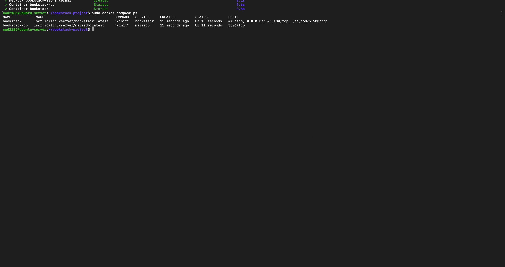

## First attempt: BookStack
I set up BookStack with MariaDB and was able to open it in a browser. I created a book and a page. I also wrote a backup script that stopped the containers, saved the persistent `data` folder in a compressed archive, and restarted the containers. Four archives were created, and the files passed a gzip check.

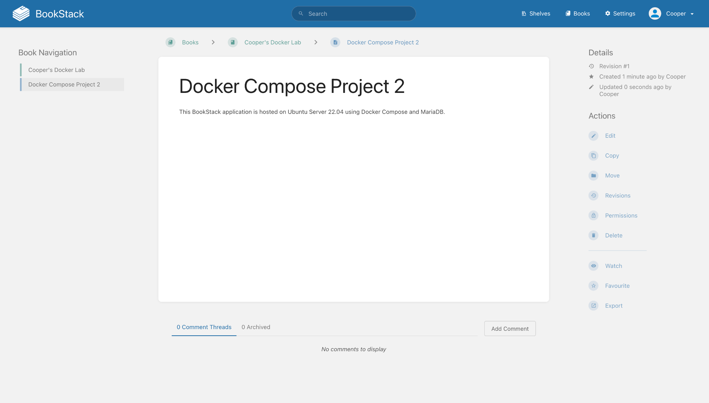
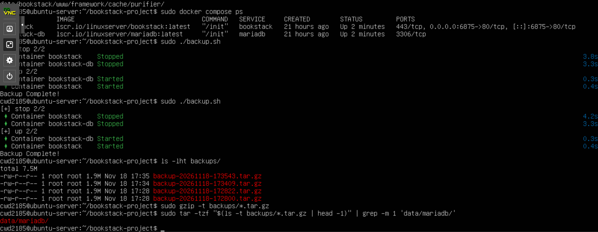

The restore test did not fully work. Even though both containers started, BookStack said the `bookstackapp.pages` table did not exist. I tried recovering the original data folder, but that did not fix the database. I kept the original data and the backup files instead of deleting them.

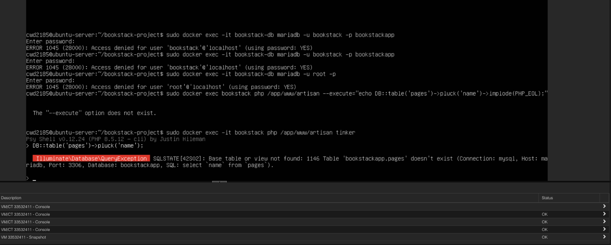

## Installing Forgejo and PostgreSQL
I made a new `~/labs` folder and wrote a `compose.yaml` file. It sets up Forgejo and PostgreSQL as two services, keeps their data in separate folders, and makes Forgejo available on port 3000. The PostgreSQL password is read from a private `.env` file. I had to fix several YAML indentation errors before Compose accepted the file.

The sanitized `compose.yaml` and `.env.example` are included with this report. The real `.env` file and administrator password are not included for security.

```bash
cd ~/labs
sudo docker compose config --quiet
sudo docker compose up -d
sudo docker compose ps
```

Both containers started. PostgreSQL showed as healthy. I completed the Forgejo initialization through the console, ran its database migration, and created an admin user. A local GET request to Forgejo returned HTTP 200.

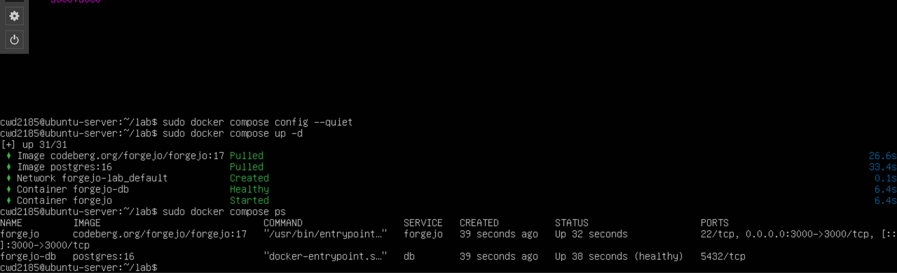
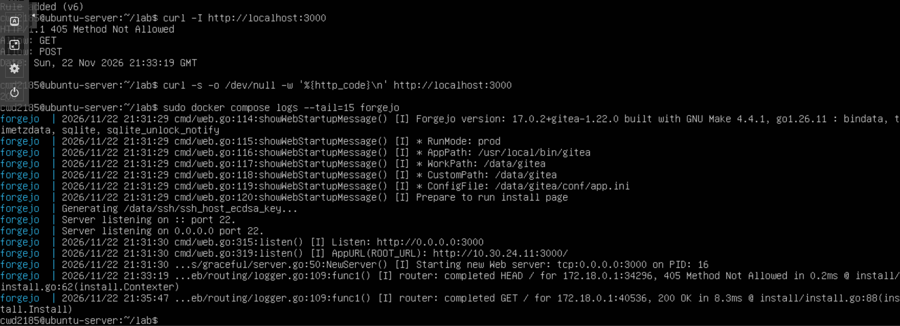

## Security steps
I configured SSH to allow public-key authentication and turn off password login. `sshd -t` passed and the SSH service was active. I also enabled UFW, allowed ports 22 and 6875 for the first app, and later allowed port 3000 for Forgejo. I turned on unattended upgrades, and both APT timers were enabled.

```text
PubkeyAuthentication yes
PasswordAuthentication no
KbdInteractiveAuthentication no
```


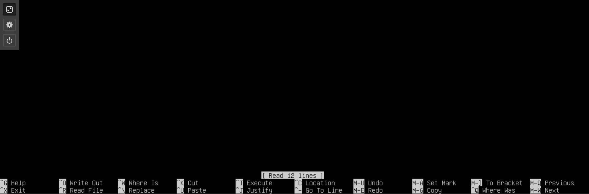

## SSH and VPN problem
SSH worked earlier, but later my Mac kept saying `Network is unreachable`. The VPN showed a route to the VM at `10.30.24.11`, but ping and SSH could not reach it. The network device `10.30.39.1` returned `Destination Host Unreachable`. I also tried my phone's hotspot with the VPN, and that did not help. The SSH service was active on Ubuntu, so I continued working directly in the Proxmox console. I could not prove the exact cause of the network problem.

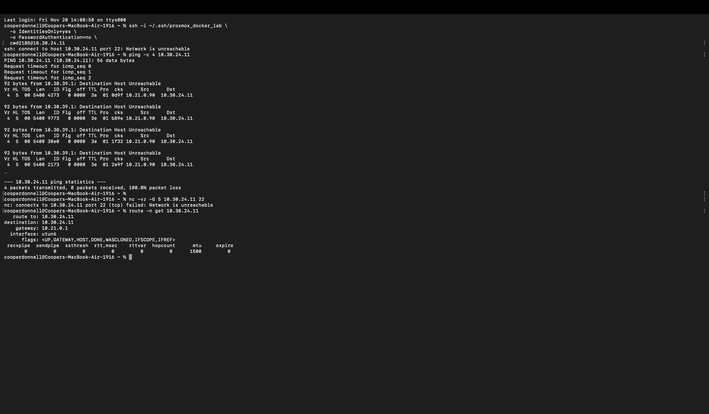

## Backing up and restoring PostgreSQL
To test the new database, I created a small table called `restore_test` and inserted a message. I made a SQL backup using `pg_dump`. The file `forgejo.sql` was about 284 KB. I then restored the SQL backup into a separate database named `forgejo_recovery` and queried the table again. The same message showed up after the restore.

```bash
sudo docker exec forgejo-db psql -U forgejo -d forgejo -c "CREATE TABLE restore_test (id INT, message TEXT);"
sudo docker exec forgejo-db psql -U forgejo -d forgejo -c "INSERT INTO restore_test VALUES (1, 'Docker backup test successful');"
sudo docker exec forgejo-db psql -U forgejo -d forgejo -c "SELECT * FROM restore_test;"
mkdir -p ~/labs/backups
sudo docker exec forgejo-db pg_dump -U forgejo -d forgejo > ~/labs/backups/forgejo.sql
sudo docker exec forgejo-db createdb -U forgejo forgejo_recovery
sudo docker exec -i forgejo-db psql -U forgejo -d forgejo_recovery < ~/labs/backups/forgejo.sql
sudo docker exec forgejo-db psql -U forgejo -d forgejo_recovery -c "SELECT * FROM restore_test;"
```

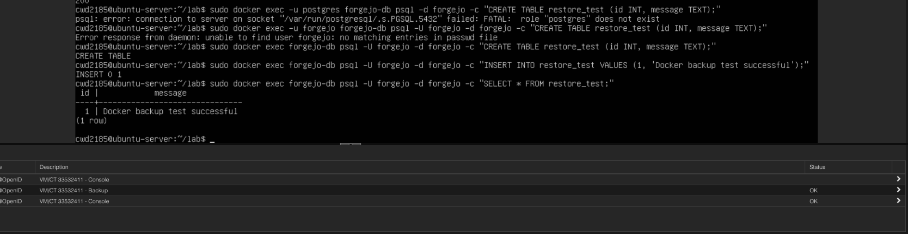
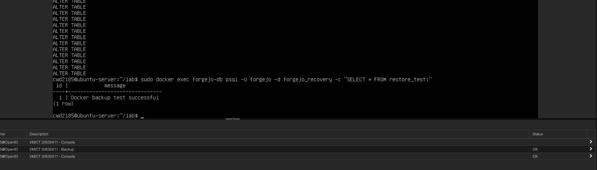

**Important:** This proves the PostgreSQL database backup restored successfully. It is not a complete test of restoring Forgejo's Git repository files; those are kept separately in the `forgejo` folder.

## Proxmox backup
I also used Proxmox to back up the whole Ubuntu virtual machine. The backup task finished with `TASK OK`, and the archive was about 5.21 GB.

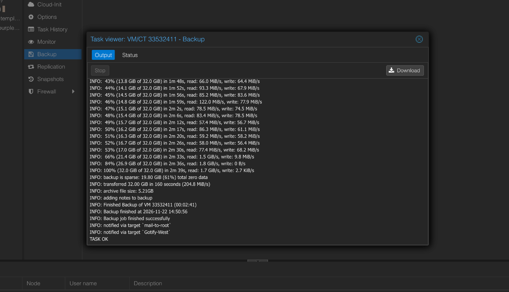

## What I learned
I learned how Docker Compose runs two services together, how to use volumes so data does not disappear when a container restarts, and how to make and test a PostgreSQL backup. I also learned that a container can say it is running even when an application database has a problem. The hardest parts were the YAML spacing, the BookStack restore, and the university VPN connection. I was still able to complete a working Forgejo deployment and verify that the PostgreSQL backup could restore my test data.

## Files included
- `compose.yaml` - sanitized example of the final Docker Compose file
- `.env.example` - placeholder for the PostgreSQL password (not the real password)
- `backup_example.sh` - example script for backing up PostgreSQL and the Forgejo files; provided for reference, not claimed as tested
- `screenshots/` - the evidence used in this report

